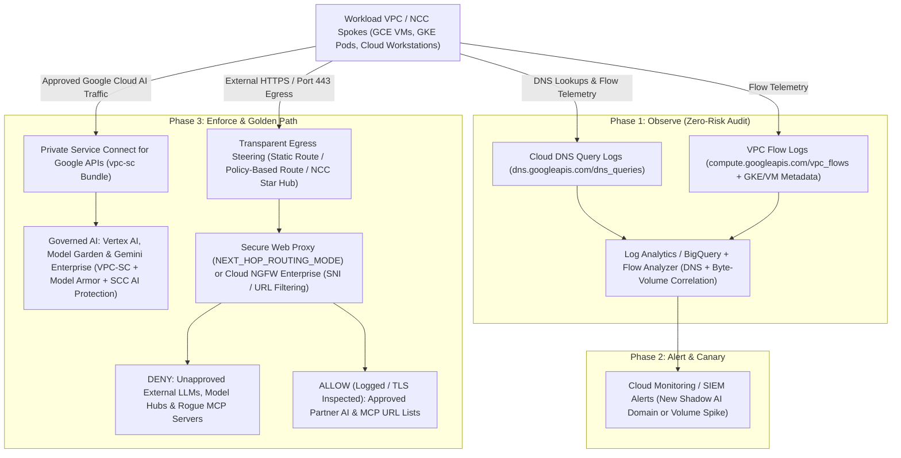

# Catching and Governing Shadow AI at the VPC Layer on Google Cloud (Without Breaking Developers)

*How to use Cloud DNS Logging, VPC Flow Logs, Secure Web Proxy, and Private Service Connect to surface hidden LLM and MCP traffic—and turn a hard security "no" into a fast, governed golden path.*

---

In almost every enterprise and public-sector architecture review I sit in today, two completely different realities exist inside the same organization.

In the CISO's office, AI adoption is officially "paused pending governance approval." Meanwhile, inside a development VPC, an engineer's Compute Engine VM, GKE pod, or Cloud Workstation is already sending application logs, database schemas, or internal documents over port 443 to an unvetted external LLM API, a personal API key on consumer Google AI Studio, a public model hub, or a third-party remote Model Context Protocol (MCP) server.

That gap is **VPC-originated Shadow AI**—and standard cloud governance tools rarely catch it on their own.

Asset-centric platforms like **Google Cloud Security Command Center (SCC) AI Protection** are essential for discovering and securing *Google Cloud-hosted* AI assets (Vertex AI endpoints, datasets, notebooks, and registered MCP servers). However, if an application container simply runs `pip install` for a third-party SDK and opens an outbound HTTPS connection to an external inference endpoint, no managed AI resource is ever created inside your Google Cloud project. From an asset-inventory standpoint, that workload looks like an ordinary VM or Kubernetes pod.

To close that blind spot, you have to instrument and govern egress **at the VPC network layer**.

In this guide, we walk through a battle-tested, **3-phase architecture** built entirely on native Google Cloud networking services:

1. **Phase 1 — Observe (Zero Production Risk):** Correlate Cloud DNS Query Logs with VPC Flow Logs in Log Analytics/BigQuery and Flow Analyzer to identify *which* workloads call external AI services and *how much data* is leaving.
2. **Phase 2 — Alert & Canary:** Flag new Shadow AI endpoints automatically and validate Layer-7 visibility before enforcing hard blocks.
3. **Phase 3 — Enforce & Redirect to the Golden Path:** Use **Secure Web Proxy in Next-Hop Routing Mode** (or **Cloud NGFW Enterprise**) for transparent Layer-7 egress filtering, while routing approved AI traffic privately to **Vertex AI**, **Model Garden**, and **Gemini Enterprise** over **Private Service Connect (PSC)** and **VPC Service Controls**.

Along the way, we will also unpack two subtle networking traps that routinely catch cloud teams off guard when securing external AI APIs.

---

## Architecture Overview: Observe, Alert, Enforce, and Redirect

Before touching a single route or firewall policy, it helps to view Shadow AI governance as a staged lifecycle rather than a day-one lockdown:



Let's build each phase step by step.

---

## Phase 1: Zero-Risk Shadow AI Discovery

The fastest way to earn buy-in from both Security and Engineering is to start with **read-only visibility**. You do not need to install host agents, modify Kubernetes manifests, or change routing tables to find Shadow AI in your VPCs.

### Discovery Trap #1: Why VPC Flow Logs Alone Are Blind to External LLMs

Many teams turn on VPC Flow Logs, open **Flow Analyzer**, and try to search for external LLM providers by destination IP address. That breaks down immediately in the real world.

Nearly every major external LLM API, AI SaaS tool, and remote MCP server sits behind shared, multi-tenant CDN and edge pools (such as Cloudflare, Fastly, or AWS CloudFront). A destination IP address in a flow log might serve a third-party LLM API on one TLS handshake and a completely benign documentation site or package registry two seconds later.

To get reliable attribution, you need **two complementary signals**:

1. **Cloud DNS Query Logs (`dns.googleapis.com/dns_queries`)** tell you *which exact domain name* a source IP resolved (`jsonPayload.queryName`) and *which IP addresses* were returned (`jsonPayload.rdata`).
2. **VPC Flow Logs (`compute.googleapis.com/vpc_flows`)** with full metadata (`INCLUDE_ALL_METADATA`) tell you *which GCE instance or GKE cluster/namespace/pod* sent traffic to that resolved IP and *how many bytes* left the VPC (`jsonPayload.bytes_sent`).

### Enabling Both Signals in Terraform

Enabling Cloud DNS logging requires a `google_dns_policy` attached to your VPC, and enabling rich VPC Flow Logs requires a `log_config` block on your workload subnets:

```hcl
# Enable Cloud DNS query logging on the workload VPC
resource "google_dns_policy" "vpc_dns_logging" {
  name           = "shadow-ai-dns-logging"
  description    = "Captures outbound DNS queries for Shadow AI discovery"
  enable_logging = true

  networks {
    network_url = google_compute_network.workload_vpc.id
  }
}

# Enable VPC Flow Logs with full VM and GKE metadata on workload subnets
resource "google_compute_subnetwork" "workload_subnet" {
  name                     = "ai-workloads-subnet"
  ip_cidr_range            = "10.10.0.0/20"
  region                   = var.region
  network                  = google_compute_network.workload_vpc.id
  private_ip_google_access = true

  log_config {
    aggregation_interval = "INTERVAL_5_MIN"
    flow_sampling        = 0.5 # Increase to 1.0 for strict audit windows
    metadata             = "INCLUDE_ALL_METADATA"
  }
}
```

> **Cost tip:** Cloud DNS query logging and high-sampling VPC Flow Logs can generate significant volume in busy clusters. Start with `flow_sampling = 0.5` (or use `filter_expr` on `log_config` to focus on external non-RFC1918 egress) and route logs into a **Log Analytics–enabled Cloud Logging bucket** so you can run BigQuery SQL directly without duplicating storage pipelines.

### Query 1: Fast Shadow AI Domain Inventory (Log Analytics SQL)

Once logs are flowing into your Log Analytics bucket (default view `` `PROJECT_ID.global._Default._AllLogs` ``, or the dedicated `shadow_ai_audit` bucket created by the companion Terraform), run a query against a curated Shadow AI domain catalog. Notice we include **four distinct risk categories**—including consumer `generativelanguage.googleapis.com`, which is often overlooked inside Google Cloud environments when developers test with personal AI Studio keys:

```sql
WITH shadow_ai_catalog AS (
  SELECT domain, category, risk_level FROM UNNEST([
    -- External LLM APIs (unapproved for unmonitored VPC egress)
    STRUCT('api.openai.com.' AS domain, 'External LLM API' AS category, 'HIGH' AS risk_level),
    STRUCT('api.anthropic.com.', 'External LLM API', 'HIGH'),
    STRUCT('api.deepseek.com.', 'External LLM API', 'CRITICAL'),
    STRUCT('api.mistral.ai.', 'External LLM API', 'HIGH'),
    STRUCT('api.cohere.ai.', 'External LLM API', 'HIGH'),
    STRUCT('openrouter.ai.', 'External AI Aggregator', 'HIGH'),
    -- Consumer Google AI Studio (potential personal API key bypass)
    STRUCT('generativelanguage.googleapis.com.', 'Consumer AI Studio API', 'HIGH'),
    -- External Model & Weight Hubs
    STRUCT('huggingface.co.', 'Model Weight Hub', 'MEDIUM'),
    STRUCT('cdn-lfs.hf.co.', 'Model Weight Hub', 'MEDIUM'),
    STRUCT('registry.ollama.ai.', 'Model Weight Hub', 'MEDIUM'),
    -- Third-Party AI Coding / Agent Endpoints
    STRUCT('api.cursor.sh.', 'External AI Code Assistant', 'MEDIUM'),
    STRUCT('api.perplexity.ai.', 'External AI Search API', 'HIGH')
  ])
)
SELECT
  c.risk_level,
  c.category,
  JSON_VALUE(l.json_payload.queryName) AS queried_domain,
  JSON_VALUE(l.json_payload.sourceIP) AS source_ip,
  COUNT(*) AS dns_queries,
  MIN(l.timestamp) AS first_seen,
  MAX(l.timestamp) AS last_seen
FROM `YOUR_PROJECT_ID.global._Default._AllLogs` AS l
JOIN shadow_ai_catalog AS c
  ON LOWER(JSON_VALUE(l.json_payload.queryName)) = c.domain
  OR ENDS_WITH(LOWER(JSON_VALUE(l.json_payload.queryName)), CONCAT('.', c.domain))
WHERE
  l.log_id = 'dns.googleapis.com/dns_queries'
  AND l.timestamp >= TIMESTAMP_SUB(CURRENT_TIMESTAMP(), INTERVAL 7 DAY)
  AND JSON_VALUE(l.json_payload.responseCode) = 'NOERROR'
GROUP BY 1, 2, 3, 4
ORDER BY
  CASE c.risk_level WHEN 'CRITICAL' THEN 1 WHEN 'HIGH' THEN 2 ELSE 3 END,
  dns_queries DESC;
```

*(Note the trailing dot in Cloud DNS `queryName`, such as `api.openai.com.`—forgetting that trailing dot is a classic reason queries return zero rows.)*

### Query 2: Correlating DNS Lookups with Actual Exfiltrated Volume (VM & GKE Attribution)

Knowing *who looked up* `api.openai.com.` is useful. Knowing that **a specific GKE workload in the `billing-analytics` namespace pushed 480 MB to that resolved IP over the last 24 hours** immediately separates a harmless health check from a real data-exfiltration risk.

```sql
WITH shadow_ai_catalog AS (
  SELECT domain, category FROM UNNEST([
    STRUCT('api.openai.com.' AS domain, 'External LLM API' AS category),
    STRUCT('api.anthropic.com.', 'External LLM API'),
    STRUCT('api.deepseek.com.', 'External LLM API'),
    STRUCT('generativelanguage.googleapis.com.', 'Consumer AI Studio API'),
    STRUCT('huggingface.co.', 'Model Weight Hub')
  ])
),
dns_resolutions AS (
  SELECT
    l.timestamp AS dns_ts,
    JSON_VALUE(l.json_payload.sourceIP) AS src_ip,
    JSON_VALUE(l.json_payload.queryName) AS queried_domain,
    c.category,
    -- Extract IPv4 addresses from rdata (which may contain space-separated records)
    resolved_ip
  FROM `YOUR_PROJECT_ID.global._Default._AllLogs` AS l
  JOIN shadow_ai_catalog AS c
    ON LOWER(JSON_VALUE(l.json_payload.queryName)) = c.domain
    OR ENDS_WITH(LOWER(JSON_VALUE(l.json_payload.queryName)), CONCAT('.', c.domain)),
  UNNEST(REGEXP_EXTRACT_ALL(JSON_VALUE(l.json_payload.rdata), r'\b(?:\d{1,3}\.){3}\d{1,3}\b')) AS resolved_ip
  WHERE
    l.log_id = 'dns.googleapis.com/dns_queries'
    AND l.timestamp >= TIMESTAMP_SUB(CURRENT_TIMESTAMP(), INTERVAL 24 HOUR)
    AND JSON_VALUE(l.json_payload.queryType) = 'A'
    AND JSON_VALUE(l.json_payload.responseCode) = 'NOERROR'
),
egress_flows AS (
  SELECT
    timestamp AS flow_ts,
    JSON_VALUE(json_payload.connection.src_ip) AS src_ip,
    JSON_VALUE(json_payload.connection.dest_ip) AS dest_ip,
    CAST(JSON_VALUE(json_payload.bytes_sent) AS INT64) AS bytes_sent,
    JSON_VALUE(json_payload.src_instance.vm_name) AS vm_name,
    JSON_VALUE(json_payload.src_gke_details.cluster.cluster_name) AS gke_cluster,
    JSON_VALUE(json_payload.src_gke_details.pod.pod_name) AS gke_pod,
    JSON_VALUE(json_payload.src_gke_details.pod.workload.workload_name) AS gke_workload
  FROM `YOUR_PROJECT_ID.global._Default._AllLogs`
  WHERE
    log_id = 'compute.googleapis.com/vpc_flows'
    AND timestamp >= TIMESTAMP_SUB(CURRENT_TIMESTAMP(), INTERVAL 24 HOUR)
    AND JSON_VALUE(json_payload.reporter) = 'SRC'
    AND JSON_VALUE(json_payload.connection.dest_port) = '443'
)
SELECT
  d.category,
  d.queried_domain,
  COALESCE(f.gke_cluster, 'GCE') AS runtime_platform,
  COALESCE(f.gke_workload, f.vm_name, f.src_ip) AS source_workload,
  COUNT(DISTINCT f.flow_ts) AS observed_flows,
  ROUND(SUM(f.bytes_sent) / (1024 * 1024), 2) AS total_mb_sent
FROM egress_flows AS f
JOIN dns_resolutions AS d
  ON f.src_ip = d.src_ip
  AND f.dest_ip = d.resolved_ip
  AND f.flow_ts BETWEEN d.dns_ts AND TIMESTAMP_ADD(d.dns_ts, INTERVAL 15 MINUTE)
GROUP BY 1, 2, 3, 4
ORDER BY total_mb_sent DESC;
```

From there, you can pivot straight into **Network Intelligence Center → Flow Analyzer** to visually chart those specific top-talker VMs or GKE clusters over time, spot unexpected nightly batch exfiltration spikes, and hand Engineering an unambiguous, data-backed list of workloads that need migration before enforcement begins.

> **What about rogue remote MCP servers?** Because external MCP servers often run on arbitrary SaaS or developer domains (e.g., `*.workers.dev`, `*.ngrok.app`, `*.trycloudflare.com`, or custom vendor domains), add tunneling/serverless edge domains to a separate `"Unvetted External Tooling / Tunnel"` watch category in your SQL catalog and watch for long-lived HTTPS/SSE connections on port 443.

---

## Phase 2: Alerting & Canary Governance

Flipping a strict egress block on overnight is the quickest way to trigger a P1 incident and lose engineering trust. Treat Phase 2 as your two-week transition buffer:

1. **Automated Shadow AI Alerts:** Turn Query 1 into a scheduled BigQuery query or a Cloud Logging log-based metric that posts to your SecOps SIEM or a security review channel whenever a *new* workload resolves a domain in your Shadow AI catalog.
2. **Canary L7 Visibility (Audit Mode):** Before enforcing blocks organization-wide, route a single non-production subnet through **Secure Web Proxy** (configured in Phase 3 below) with `basic_profile = "ALLOW"` on the Shadow AI URL list. This achieves two things:
   * It verifies application compatibility with zero downtime.
   * It catches workloads that bypassed Cloud DNS altogether (for example, using hardcoded public IPs or custom DNS-over-HTTPS resolvers), because Secure Web Proxy inspects the actual TLS **Server Name Indication (SNI)** / HTTP `Host` header at Layer 7.

---

## Enforcement Trap #2: Why L3/L4 `dest_fqdns` Firewall Rules Break on AI APIs

When security teams move to Phase 3 (blocking unapproved AI egress), the first instinct is usually: *"Let's add a Cloud NGFW firewall policy rule with `dest_fqdns = ['api.openai.com']` and action `DENY`."*

**Be very careful with that approach.** Here is why L3/L4 FQDN firewall rules are a poor fit for modern external AI APIs:

* **Cloud NGFW `dest_fqdns` enforces at Layer 3 (IP address), not Layer 7 (hostname).** Under the hood, Cloud NGFW resolves FQDNs to IPs via Cloud DNS and programs IP-based rules.
* **CDN IP sharing causes collateral damage:** If `api.example-ai.com` sits behind a shared Cloudflare or Fastly edge IP, a `DENY` rule targeting that resolved IP can silently block *unrelated, legitimate SaaS services* sharing the same edge pool—while an `ALLOW` rule can inadvertently open access to thousands of unrelated tenants on that IP.
* **Low DNS TTLs (<90 seconds) cause flapping:** Global AI APIs routinely rotate edge IPs with 30-to-60-second DNS TTLs. Google Cloud documentation explicitly cautions against relying on `dest_fqdns` for records with TTLs under 90 seconds, as DNS/firewall sync drift can cause intermittent timeouts or brief policy bypasses.

### Choosing the Right Google Cloud Control

| Capability | Layer | Safe on Shared CDN IPs? | Zero Workload Proxy Config? | Best Fit for AI Egress Governance |
| :--- | :--- | :--- | :--- | :--- |
| **Cloud NGFW (`dest_fqdns`)** | L3/L4 (IP-resolved) | No (shared IP & <90s TTL risk) | Yes | Destinations with dedicated, static/long-TTL IPs only |
| **Secure Web Proxy (`NEXT_HOP_ROUTING_MODE`)** | L7 (SNI / Host / URL + optional TLS Inspection) | **Yes** | **Yes** (via static route, PBR, or NCC Star Hub) | Dedicated egress web/API/MCP governance with reusable `url_lists` and CEL rules |
| **Cloud NGFW Enterprise (URL Filtering + TLS Inspection)** | L7 (SNI / URL / IPS) | **Yes** | **Yes** (inline VPC firewall policy) | Orgs already standardizing on Cloud NGFW Enterprise for unified IPS + L7 SNI filtering without separate proxy gateways |
| **VPC Service Controls + PSC (`vpc-sc`)** | API Perimeter + Private VIP | N/A (Google APIs) | **Yes** | Locking down Google Cloud AI APIs (`aiplatform`, `generativelanguage`) and stopping personal API key / cross-project exfiltration |

For most organizations that want clean, version-controlled URL lists and transparent enforcement across both VMs and GKE pods, **Secure Web Proxy in `NEXT_HOP_ROUTING_MODE`** (paired with **PSC + VPC-SC** for Google APIs) hits the sweet spot. If you already run **Cloud NGFW Enterprise**, its SNI-based URL Filtering achieves the same CDN-safe Layer-7 domain control directly inside your firewall policies without full TLS decryption unless you need URL-path inspection.

---

## Phase 3: Transparent Egress Enforcement with Secure Web Proxy

Historically, enterprise web proxies failed in cloud-native environments because engineers hated configuring `HTTP_PROXY` / `HTTPS_PROXY` environment variables across every VM, container image, and Python SDK—and a single misconfigured container bypassed the proxy altogether.

Google Cloud's **Secure Web Proxy** solves this with **`NEXT_HOP_ROUTING_MODE`**. Instead of configuring clients, you steer outbound traffic transparently using standard VPC static routes, Policy-Based Routes (PBR), or a centralized **Network Connectivity Center (NCC) Star Hub**.

### Terraform Blueprint: SWP in `NEXT_HOP_ROUTING_MODE` with AI URL Lists

Below is a clean, modular Terraform setup that:
1. Provisions the required regional `REGIONAL_MANAGED_PROXY` subnet.
2. Defines two reusable `google_network_security_url_lists`: one for **explicitly approved partner AI/MCP endpoints**, and one for **blocked Shadow AI endpoints**.
3. Attaches a `google_network_services_gateway` (`type = "SECURE_WEB_GATEWAY"`) in `NEXT_HOP_ROUTING_MODE`.
4. Steers traffic transparently from tagged workloads using Policy-Based Routes (`google_network_connectivity_policy_based_route`) with safe `DEFAULT_ROUTING` bypass rules for internal VPC/PSC traffic and IAP SSH.

```hcl
# 1. Required Regional Proxy-Only Subnet for Secure Web Proxy
resource "google_compute_subnetwork" "swp_proxy_subnet" {
  name          = "swp-proxy-only-subnet"
  ip_cidr_range = "10.129.0.0/23"
  region        = var.region
  network       = google_compute_network.workload_vpc.id
  purpose       = "REGIONAL_MANAGED_PROXY"
  role          = "ACTIVE"
}

# 2. Reusable URL Lists (managed via GitOps / PR review)
resource "google_network_security_url_lists" "approved_external_ai" {
  name        = "approved-external-ai-mcp"
  location    = var.region
  description = "External AI/MCP endpoints formally approved by Security"
  values = [
    "mcp.approved-partner.example.com"
  ]
}

resource "google_network_security_url_lists" "blocked_shadow_ai" {
  name        = "blocked-shadow-ai-domains"
  location    = var.region
  description = "Unapproved external LLM APIs and model hubs"
  values = [
    "api.openai.com",
    "*.openai.com",
    "api.anthropic.com",
    "api.deepseek.com",
    "api.mistral.ai",
    "api.cohere.ai",
    "openrouter.ai",
    "huggingface.co",
    "*.hf.co",
    "generativelanguage.googleapis.com"
  ]
}

# 3. Gateway Security Policy & Rules (evaluated by ascending priority)
resource "google_network_security_gateway_security_policy" "ai_egress_policy" {
  name        = "ai-egress-governance-policy"
  location    = var.region
  description = "L7 SNI/Host egress governance for AI workloads"
  # Optional: attach tls_inspection_policy when URL-path or header inspection is required
}

# Priority 100: Explicitly ALLOW vetted external AI/MCP partner endpoints
resource "google_network_security_gateway_security_policy_rule" "allow_approved_ai" {
  name                    = "allow-approved-external-ai"
  location                = var.region
  gateway_security_policy = google_network_security_gateway_security_policy.ai_egress_policy.name
  enabled                 = true
  priority                = 100
  session_matcher         = "inUrlList(host(), '${google_network_security_url_lists.approved_external_ai.id}')"
  basic_profile           = "ALLOW"
}

# Priority 200: Explicitly DENY Shadow AI domains (flip to ALLOW during Phase 2 canary)
resource "google_network_security_gateway_security_policy_rule" "deny_shadow_ai" {
  name                    = "deny-shadow-ai-egress"
  location                = var.region
  gateway_security_policy = google_network_security_gateway_security_policy.ai_egress_policy.name
  enabled                 = true
  priority                = 200
  session_matcher         = "inUrlList(host(), '${google_network_security_url_lists.blocked_shadow_ai.id}')"
  basic_profile           = "DENY"
}

# Priority 900: Allow remaining standard HTTPS egress (or switch to default-deny in high-security envs)
resource "google_network_security_gateway_security_policy_rule" "allow_general_web" {
  name                    = "allow-general-https"
  location                = var.region
  gateway_security_policy = google_network_security_gateway_security_policy.ai_egress_policy.name
  enabled                 = true
  priority                = 900
  session_matcher         = "host() != ''"
  basic_profile           = "ALLOW"
}

# 4. Secure Web Proxy Gateway in NEXT_HOP_ROUTING_MODE
resource "google_network_services_gateway" "ai_swp_next_hop" {
  name                                 = "ai-egress-swp-nexthop"
  location                             = var.region
  type                                 = "SECURE_WEB_GATEWAY"
  routing_mode                         = "NEXT_HOP_ROUTING_MODE"
  scope                                = "ai-egress-scope"
  ports                                = [443]
  addresses                            = ["10.10.0.250"]
  network                              = google_compute_network.workload_vpc.id
  subnetwork                           = google_compute_subnetwork.workload_subnet.id
  gateway_security_policy              = google_network_security_gateway_security_policy.ai_egress_policy.id
  certificate_urls                     = [google_certificate_manager_certificate.swp_cert.id]
  delete_swg_autogen_router_on_destroy = true

  depends_on = [google_compute_subnetwork.swp_proxy_subnet]
}

# 5. Transparent Traffic Steering via Policy-Based Route (zero client config)
# Note: Pair with higher-priority DEFAULT_ROUTING bypass PBRs for 10.0.0.0/8 (VPC/PSC),
# 35.235.240.0/20 (IAP SSH), 169.254.169.254/32 (Metadata), and 199.36.153.4/30 (restricted VIP).
# See 02-enforcement-swp/main.tf in the companion repo for the full bypass block.
resource "google_network_connectivity_policy_based_route" "steer_egress_to_swp" {
  name        = "steer-ai-workloads-to-swp"
  description = "Transparently routes TCP/443 internet egress from governed subnets to SWP"
  network     = google_compute_network.workload_vpc.id
  priority    = 500

  filter {
    protocol_version = "IPV4"
    ip_protocol      = "TCP"
    src_range        = "10.10.0.0/20"
    dest_range       = "0.0.0.0/0"
  }

  next_hop_ilb_ip = google_network_services_gateway.ai_swp_next_hop.addresses[0]

  virtual_machine {
    tags = ["governed-ai-egress"]
  }
}
```

### Operational Caveats Worth Knowing Before Deployment

* **Regional scope:** Secure Web Proxy is regional; workloads must be in the same region as the SWP instance when using `NEXT_HOP_ROUTING_MODE`.
* **Supported protocols:** In `NEXT_HOP_ROUTING_MODE`, SWP handles HTTP(S) and TCP proxy traffic; non-TCP traffic (such as UDP/QUIC) routed to it is dropped. Scoping your Policy-Based Route to `ip_protocol = "TCP"` (and restricting UDP/443 QUIC egress via firewall policy so browsers/clients cleanly negotiate HTTPS over TCP/443) avoids surprise packet drops.
* **Scaling to multi-VPC organizations:** Instead of deploying a separate SWP in every workload VPC, attach spoke VPCs to a **Network Connectivity Center (NCC) Star Hub** and place Secure Web Proxy + Cloud NAT in the central egress transit VPC.
* **When to add TLS Inspection:** SNI matching (`host()`) blocks unapproved domains without decrypting traffic or managing client trust stores. Enable a **TLS Inspection Policy** (backed by Certificate Authority Service) only when you need **URL-path or header-level control**—for instance, allowing `mcp.vendor.com/v1/readonly/*` while blocking `mcp.vendor.com/v1/write/*`.

---

## The Golden Path: Make Governed AI Easier Than Shadow AI

Every experienced security architect knows the unwritten law of developer productivity: **if you block an external tool without offering a frictionless, approved alternative, developers will find a new bypass by Friday.**

The goal isn't to stop engineers from using frontier models—it's to route them onto a **governed, private Golden Path** where they can access **Gemini**, enterprise **Model Garden** (including third-party and open-weight models under Google Cloud terms and Zero Data Retention), and **Gemini Enterprise** with *lower latency* and zero API-key sprawl.

### Private Service Connect (PSC) for Google APIs + VPC Service Controls

Instead of sending Google Cloud AI traffic out through Secure Web Proxy and Cloud NAT, keep it completely off the public internet using a **Private Service Connect endpoint for Google APIs** targeting the **`vpc-sc`** bundle:

```hcl
# 1. Reserve a Global Internal IP for PSC -> Google APIs (VPC-SC bundle)
resource "google_compute_global_address" "psc_vpc_sc_ip" {
  name         = "psc-vpc-sc-ip"
  address_type = "INTERNAL"
  purpose      = "PRIVATE_SERVICE_CONNECT"
  network      = google_compute_network.workload_vpc.id
  address      = "10.10.254.10"
}

# 2. Global Forwarding Rule targeting the "vpc-sc" bundle
# Note: PSC Google APIs forwarding rule names must be 1-20 lowercase alphanumeric chars (no hyphens).
resource "google_compute_global_forwarding_rule" "psc_vpc_sc" {
  name                  = "pscvpcscai"
  network               = google_compute_network.workload_vpc.id
  ip_address            = google_compute_global_address.psc_vpc_sc_ip.id
  target                = "vpc-sc"
  load_balancing_scheme = ""
}

# 3. Private Cloud DNS Zone mapping *.googleapis.com to the internal PSC IP
resource "google_dns_managed_zone" "private_googleapis" {
  name        = "private-googleapis-zone"
  dns_name    = "googleapis.com."
  description = "Routes Google APIs privately to the VPC-SC PSC endpoint"
  visibility  = "private"

  private_visibility_config {
    networks {
      network_url = google_compute_network.workload_vpc.id
    }
  }
}

resource "google_dns_record_set" "googleapis_wildcard" {
  name         = "*.${google_dns_managed_zone.private_googleapis.dns_name}"
  managed_zone = google_dns_managed_zone.private_googleapis.name
  type         = "A"
  ttl          = 300
  rrdatas      = [google_compute_global_address.psc_vpc_sc_ip.address]
}
```

### Closing the Personal AI Studio API Key Loophole

Notice an important detail about `generativelanguage.googleapis.com` (the Gemini Developer / AI Studio API):

* Both **`aiplatform.googleapis.com`** (Vertex AI) and **`generativelanguage.googleapis.com`** integrate with **VPC Service Controls** and are reachable over the `vpc-sc` / `restricted.googleapis.com` VIP.
* When you add **both** `aiplatform.googleapis.com` and `generativelanguage.googleapis.com` to your VPC-SC Service Perimeter's restricted services list and route `*.googleapis.com` to your internal `vpc-sc` PSC IP, **any developer inside your VPC who tries to call `generativelanguage.googleapis.com` using a personal or external-project AI Studio API key is blocked immediately at the perimeter boundary**.
* Meanwhile, if your organization standardizes exclusively on Vertex AI (`*-aiplatform.googleapis.com`), you can additionally leave `generativelanguage.googleapis.com` disabled via Organization Policy / Service Usage while keeping regional Vertex AI and Model Garden seamlessly accessible over the internal `10.10.254.10` PSC IP—never touching Cloud NAT or Secure Web Proxy.

Layer **Model Armor** (for inline prompt-injection and sensitive-data screening) and **SCC AI Protection** (for continuous asset, vulnerability, and agent/MCP posture discovery) on top of that Golden Path, and you now have defense-in-depth across *both* the cloud asset layer and the VPC network layer.

---

## Putting It to the Test: A 10-Minute End-to-End Verification

When piloting this architecture in a sandbox project (or demonstrating it to your security team), run a simple 4-step verification from a test GCE VM or GKE pod inside the workload subnet:

```bash
# 1. Verify DNS resolution for Google Cloud AI stays private (resolves to 10.10.254.10 PSC IP)
dig +short us-central1-aiplatform.googleapis.com

# 2. Simulate an unapproved external LLM API call (should succeed in Phase 1, fail in Phase 3)
curl -sv --max-time 5 https://api.openai.com/v1/models

# 3. Simulate an unapproved model hub pull (should log in Phase 1, block in Phase 3)
curl -sv --max-time 5 https://huggingface.co/

# 4. Call governed Vertex AI over the private PSC Golden Path (succeeds in all phases)
curl -s -X POST \
  -H "Authorization: Bearer $(gcloud auth print-access-token)" \
  -H "Content-Type: application/json" \
  "https://us-central1-aiplatform.googleapis.com/v1/projects/${PROJECT_ID}/locations/us-central1/publishers/google/models/gemini-2.5-flash:generateContent" \
  -d '{"contents":[{"role":"user","parts":[{"text":"Confirm private connectivity."}]}]}'
```

**What you will observe across the phases:**
* **In Phase 1 (Before SWP routing):** Calls 2 and 3 connect—and within minutes, Query 1 and Query 2 surface the exact source VM/pod, destination domain, and outbound bytes in Log Analytics, while Flow Analyzer graphs the spike.
* **In Phase 3 (After enabling SWP `NEXT_HOP_ROUTING_MODE` + PSC/VPC-SC):** Calls 2 and 3 are cleanly terminated by Secure Web Proxy at Layer 7 and logged to Cloud Logging with the matched `deny-shadow-ai-egress` rule—without touching a single proxy environment variable on the VM—while Call 4 succeeds privately over `10.10.254.10` inside your VPC-SC perimeter.

---

## Your 1-Hour Shadow AI Audit Checklist

You don't need a six-month security transformation program to get value from this architecture. You can run a **read-only Shadow AI VPC Audit in under an hour**:

1. **Confirm telemetry:** Verify whether Cloud DNS Query Logging (`enable_logging = true`) and VPC Flow Logs (`INCLUDE_ALL_METADATA`) are enabled on your highest-risk dev, data-science, and GKE subnets.
2. **Run Query 1 & Query 2** in Log Analytics against the last 7 days of logs to build an objective baseline of external LLM APIs, consumer AI Studio keys, model hubs, and unexpected tunnel/MCP endpoints.
3. **Review top talkers in Flow Analyzer** alongside app owners—distinguishing sanctioned experiments from risky production data leaks.
4. **Provision the Golden Path first:** Deploy PSC (`target = "vpc-sc"`) + Private Cloud DNS + Vertex AI / Model Garden access so developers have an immediate, faster landing spot.
5. **Roll out SWP (`NEXT_HOP_ROUTING_MODE`) or Cloud NGFW Enterprise URL Filtering** in canary `ALLOW`-with-logging mode for two weeks, then flip your Shadow AI URL list to `DENY`.

*Companion Terraform modules, Log Analytics SQL scripts, and the verification simulator are available in the companion repository: [github.com/mfrieder123/gcp-vpc-shadow-ai-governance](https://github.com/mfrieder123/gcp-vpc-shadow-ai-governance).*

---

*Opinions and architectural recommendations expressed in this article are my own and do not necessarily represent official Google Cloud product statements. Always validate configurations in a non-production sandbox environment before rolling out egress routing changes.*
